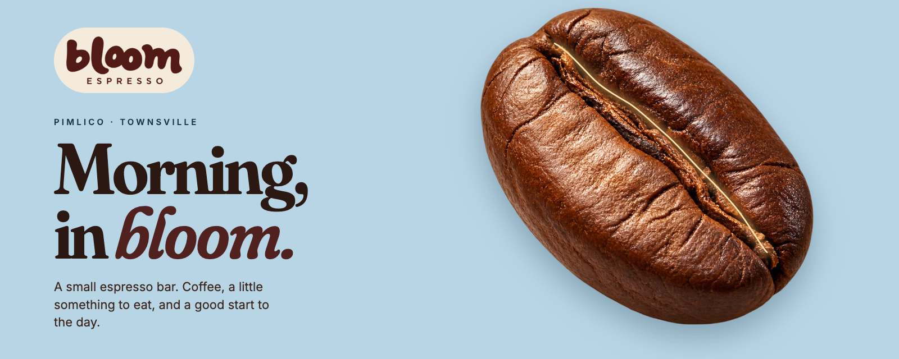
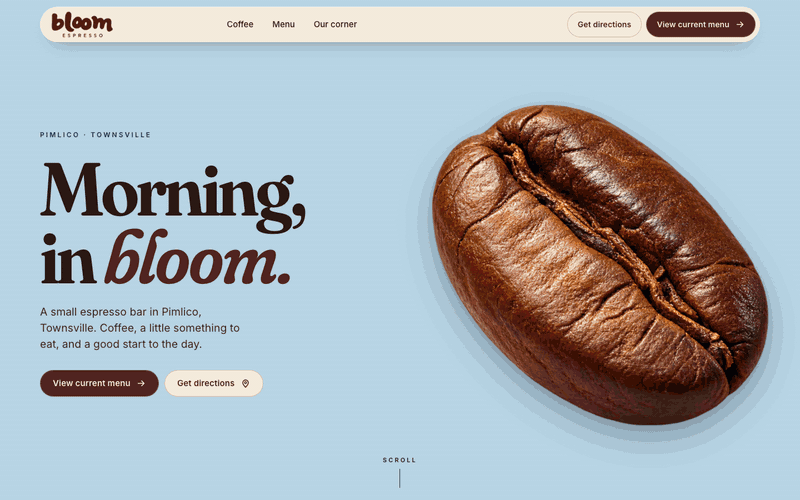
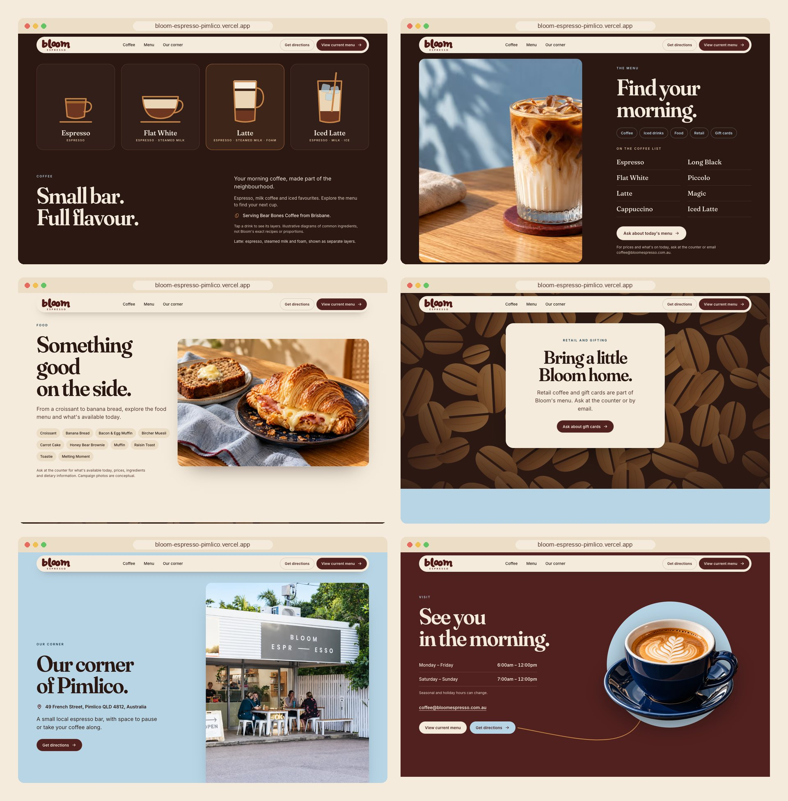
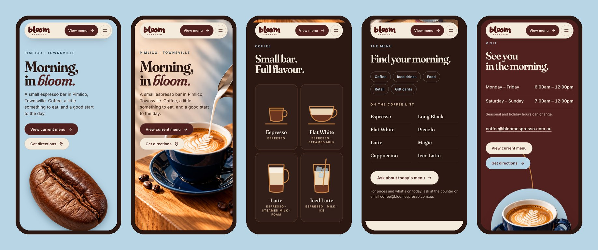
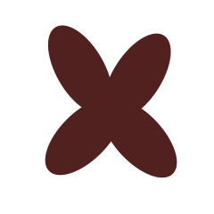

<div align="center">



<h3>A one-page website for a small espresso bar in Pimlico, Townsville, built around a scroll-driven journey from a single coffee bean to the cup.</h3>

<p>
  <a href="https://bloom-espresso-pimlico.vercel.app"><strong>🌐 Live site</strong></a>
  &nbsp;·&nbsp;
  <a href="#hero-animation"><strong>🎬 How the hero works</strong></a>
  &nbsp;·&nbsp;
  <a href="#getting-started"><strong>🛠️ Run it locally</strong></a>
</p>

<p>
  <a href="https://bloom-espresso-pimlico.vercel.app"></a>
  
  
  
  
</p>

</div>

<br />

## 🚀 Overview

**Bloom Espresso** is a small espresso bar on French Street in Pimlico, Townsville. The site tells its morning in one gesture: the page opens on a single roasted bean on powder blue, light runs along its crease, and the crease **opens like a window** onto a latte being poured. Keep scrolling and the cup's crema spreads into an espresso-dark screen, where four drink diagrams lift out of the cup and land in the next section as a little illustrated menu.

From there the page stays simple and useful: the coffee, the menu, the food, retail and gift cards, the shopfront, and the hours. Prices and today's availability are a question for the counter or Bloom's email.

- **Cinematic first impression**: a scroll-scrubbed 2D film made of real photos, a cut-out bean and measured masks, not a video
- **Useful straight away**: headline, *View current menu* and *Get directions* are live from the first frame; nothing blocks the page
- **Honest content**: names, address, email and hours come from Bloom's own pages; no prices, ratings, stock or phone numbers are invented
- **Light**: first load is about **220 KB on a phone** and **285 KB on desktop**, fonts included

<br />

<a name="hero-animation"></a>

## 🎬 The hero animation

<div align="center">
  <a href="https://bloom-espresso-pimlico.vercel.app"></a>
  <sub>Scroll-scrubbed on the live site · captured at 1440 × 900</sub>
</div>

<br />

On desktop the hero is a 220svh track with a sticky stage (1.2 screens of scroll), following the kit's scroll script:

| Scroll   | What happens                                                                                              |
| :------- | :-------------------------------------------------------------------------------------------------------- |
| 0–16%    | **The bean.** A cut-out bean on powder blue; a warm line of light runs along its crease                   |
| 16–40%   | **Aperture.** The crease opens as a slit, then a rounded window; the latte art is the first thing seen    |
| 40–60%   | **The cup.** Milk pours into the latte; the oak block settles back to the approved framing                |
| 60–84%   | **Layers.** The crema grows into an espresso-brown screen; four drink diagrams rise out of the cup         |
| 84–100%  | **Hand-off.** The diagrams wait while *Small bar. Full flavour.* rises to meet them, then become its cards |

**Under the hood**

- 📐 **Measured, not guessed.** The crease path was scanned from the cut-out bean's pixels (darkest opaque pixel per column), smoothed and stored in `src/data/geometry.js`. The light and the aperture follow it exactly.
- 🪟 **Masks, not morphs.** The opening is a rotated elliptical `clip-path` that starts as a thin slit and grows to cover the screen. Nothing pretends to rotate or morph the bean.
- 🎯 **Focal point first.** The latte photo starts with its crema centred on the opening and eases into its resting framing, so the slit never opens onto an empty saucer. While the window is small the photo may move freely; it is pulled back to full coverage as the window fills the screen.
- 🔁 **Pixel-exact hand-off.** Fixed clones of the four diagrams travel from the cup to the measured slots in `#coffee`. They stay still while the page rises, then the in-flow cards take over within 0.4 px (measured at 1024, 1280, 1440 and 1920 px). Nav links and `/#coffee` land at the end of the hand-off.
- 🐢 **Graceful by default.** Phones and portrait tablets get a 145svh version with the bean below the buttons. Reduced motion, short screens and no-JS visits get the finished latte hero as a still. `?nosmooth` and `?p=0.5` exist for captures.

<br />

## 🖥️ Sections

<div align="center">
  
</div>

<br />

| #   | Section                              | Anchor    | Role                                                                                         |
| :-- | :----------------------------------- | :-------- | :------------------------------------------------------------------------------------------- |
| 01  | **Morning, in bloom.**               | `#top`    | Bean-to-cup hero, *View current menu* and *Get directions*                                    |
| 02  | **Small bar. Full flavour.**         | `#coffee` | Four illustrated drinks (tap to separate the layers) and the supplier note                   |
| 03  | **Find your morning.**               | `#menu`   | Menu categories and drink names from Bloom's menu; every *View current menu* button lands here |
| 04  | **Something good on the side.**      | `#food`   | Food names from the menu; availability and dietary info at the counter                        |
| 05  | **Bring a little Bloom home.**       | `#retail` | Retail coffee and gift cards, with an email CTA, over a field of honey-wood beans             |
| 06  | **Our corner of Pimlico.**           | `#corner` | Address, the shopfront photo with its unedited original beside it, directions                 |
| 07  | **See you in the morning.**          | `#visit`  | Hours and email; a caramel line runs from the cup to *Get directions*                         |
| 08  | Footer                               | n/a       | Logo, Menu · Directions · Email, a note that campaign photos are conceptual                  |

<br />

## 📱 Mobile first, motion optional

<div align="center">
  
</div>

<br />

- A shorter hero (145svh) with the bean placed below the call-to-action buttons
- Drinks in two columns of large tap targets; the menu list in two columns; everything else stacks
- Every touch target is at least 44 px; no horizontal scroll from 320 to 1920 px, fixed header included
- Nothing depends on hover: tapping a drink separates its layers and announces them to screen readers

<br />

## ✨ Highlights

- **🎞️ Scroll storytelling**: a small custom engine (no animation library) maps scroll progress to the kit's timeline in `src/data/timeline.js`
- **☕ Drink diagrams as real UI**: SVG cups with separate liquid layers that lift apart on hover, focus or tap, labelled in HTML and clearly marked as illustrative, not Bloom's recipes
- **🧾 Facts in one file**: address, hours, email and links live in `src/data/site.js` and are written into the HTML at build time, so they work without JavaScript
- **🖼️ Image pipeline**: kit PNGs stay untouched; `npm run images` exports AVIF + WebP per width, the Open Graph card and the icons; the hero bean is preloaded
- **🔤 Fonts trimmed**: Fraunces instanced and subset from 264 KB to 67 KB (`scripts/subset-fonts.py`), Inter self-hosted
- **🧭 Honest location**: the shopfront photo is shown with its unedited original next to it, as the kit asks
- **🔎 Ready to share**: Open Graph image and `CafeOrCoffeeShop` structured data with opening hours

<br />

## 💻 Tech stack

| <br />Vite 6 | <br />JavaScript | <br />HTML5 | <br />CSS3 | <br />sharp | <br />Vercel |
| :---: | :---: | :---: | :---: | :---: | :---: |

### Why this stack?

- **Vite + plain JavaScript**: a one-page site for a café doesn't need a framework runtime; the page is static HTML with about 14 KB of script (6 KB gzipped)
- **A custom scroll engine instead of GSAP**: the hero is a single progress value driving transforms and clip-paths, which a few dozen lines handle with full control over the hand-off
- **sharp**: one script turns the kit's PNGs into responsive AVIF/WebP, the share card and the icons
- **Self-hosted Fraunces + Inter**: the kit's suggested pairing, with no third-party font requests
- **Vercel**: every push to `main` deploys automatically

<br />

## 🎨 Design system

| Token     | Value                                                                        | Use                                              |
| :-------- | :--------------------------------------------------------------------------- | :----------------------------------------------- |
| Oat       |  | Page ground, navigation, food, footer            |
| Burgundy  |  | Logo, primary buttons, *bloom.*, Visit band      |
| Blue      |  | Hero ground, Our corner, labels on dark          |
| Espresso  |  | Body text, Coffee / Menu / Retail bands          |
| Caramel   |  | Diagram outlines, flow line, focus ring (decorative only) |
| Navy      |  | Eyebrows on light grounds                        |

- **Type**: Fraunces for headings (hero 72–152 px on desktop, 54–76 px on mobile), Inter for body at 17 px with 1.55 line height
- **Grid**: 12 columns on desktop, 1,440 px max width, 5vw margins (20 px minimum on phones)
- **Contrast**: dark text on oat and blue, light text on espresso and burgundy; every text pair measures 7:1 or better, and the focus ring switches between burgundy and blue per band
- **Motion**: reveals of 28 px over 700 ms, photo masks over 1.1 s, a 400 ms fade for the shopfront; all off with reduced motion

<br />

<a name="getting-started"></a>

## 🛠️ Getting started

```bash
# Clone the repository
git clone https://github.com/Jeanfr1/bloom-espressowebsite.git
cd bloom-espressowebsite

# Install dependencies (Node 20.10+)
npm install

# Start the dev server  →  http://localhost:5173
npm run dev

# Production build  →  dist/
npm run build

# Preview the production build
npm run preview

# Regenerate AVIF/WebP images, the share card and icons from the kit PNGs
npm run images
```

<br />

## 📁 Project structure

```
bloom-espressowebsite/
├── index.html                  # Every section: hero → coffee → menu → food → retail → corner → visit → footer
├── vite.config.js              # Writes site facts, <picture> sets, drink cards and JSON-LD into the HTML
├── src/
│   ├── css/                    # main.css (tokens, nav, buttons), hero.css, sections.css
│   ├── js/
│   │   ├── main.js             # Entry
│   │   ├── hero.js             # Scroll engine: crease light, aperture, cup, espresso, dock into #coffee
│   │   └── ui.js               # Navigation sheet, drink picker, reveals, flow line, bean field
│   ├── data/
│   │   ├── site.js             # Address, hours, email, links, menu names (single source of facts)
│   │   ├── timeline.js         # Scroll script (desktop and compact)
│   │   ├── geometry.js         # Measured crease path and crema positions
│   │   ├── diagrams.js         # Drink SVGs
│   │   └── images.json         # Generated image manifest
│   └── fonts/                  # Trimmed Fraunces (generated)
├── scripts/
│   ├── build-images.mjs        # PNG → AVIF/WebP, OG card, icons (sharp)
│   ├── prepare-sources.mjs     # Trimmed logo and the original shopfront photo → assets-src/
│   └── subset-fonts.py         # Fraunces instancing and subsetting (fonttools)
├── public/                     # Generated images, favicon, Open Graph card
├── 01-identidade … 08-estudo/  # The creative kit (kept in the repo, excluded from the deploy)
└── LEIA-ME-KIT.md              # The kit's own read-me
```

<br />

## 🚀 Deployment

Hosted on **Vercel** and connected to this repository: every push to `main` ships to production.

**Live site:** [bloom-espresso-pimlico.vercel.app](https://bloom-espresso-pimlico.vercel.app)

| Setting          | Value           |
| :--------------- | :-------------- |
| Framework        | Vite            |
| Build command    | `npm run build` |
| Output directory | `dist`          |

<br />

## 📌 Content checklist

Items waiting on Bloom. Each code item is marked `TODO(bloom)`.

- [ ] Reconfirm opening hours, including seasonal and holiday changes (`src/data/site.js`)
- [ ] Reconfirm the Bear Bones Coffee supplier note before launch
- [ ] **Bloom's website is down**: bloomespresso.com.au answered 404 on 2026-10-09. *View current menu* scrolls to the on-page menu and price / gift-card questions go to the email. When the site or its order page is back and tested, point those buttons at it again
- [ ] The Google Maps place link for the shop (directions currently search the address)
- [ ] Official logo files (the current logo is a reconstruction of the lettering from Bloom's profile)
- [ ] The original shopfront photo file, to replace the edited version
- [ ] Confirm the campaign photos (latte, food, iced latte) are acceptable as conceptual images
- [ ] Final domain, then add `canonical` / `og:url` and remove `noindex`

Choices made where the kit disagreed with itself:

- **Copy file over mockup text.** The mockups carry taglines that the copy file does not (*Great coffee, brighter days*, *Proper coffee, simply done*, *Bold & smooth*…). The kit says to build from the copy file, so those lines are not used.
- **Diagrams live in *Coffee*.** The copy file puts the diagrams in *The menu*, but the hero hands them off to the section right after it. They now open *Small bar. Full flavour.*, and *Find your morning.* follows directly in the same espresso band.

<br />

## 🙏 Acknowledgments

- **Bloom Espresso** for the brief, the creative kit and the visual direction
- **[Fraunces](https://fonts.google.com/specimen/Fraunces)** by Undercase Type (OFL) and **[Inter](https://rsms.me/inter/)** by Rasmus Andersson (OFL)
- **[sharp](https://sharp.pixelplumbing.com)** for the image pipeline
- **[Vite](https://vite.dev)** and **[Vercel](https://vercel.com)**

<br />

---

<div align="center">
  
  <p><strong>Morning, in bloom.</strong></p>
  <p>Built with ❤️ by <a href="https://github.com/Jeanfr1">Jean</a> for Bloom Espresso</p>
  <sub>© 2026 Bloom Espresso. All rights reserved.</sub>
</div>
